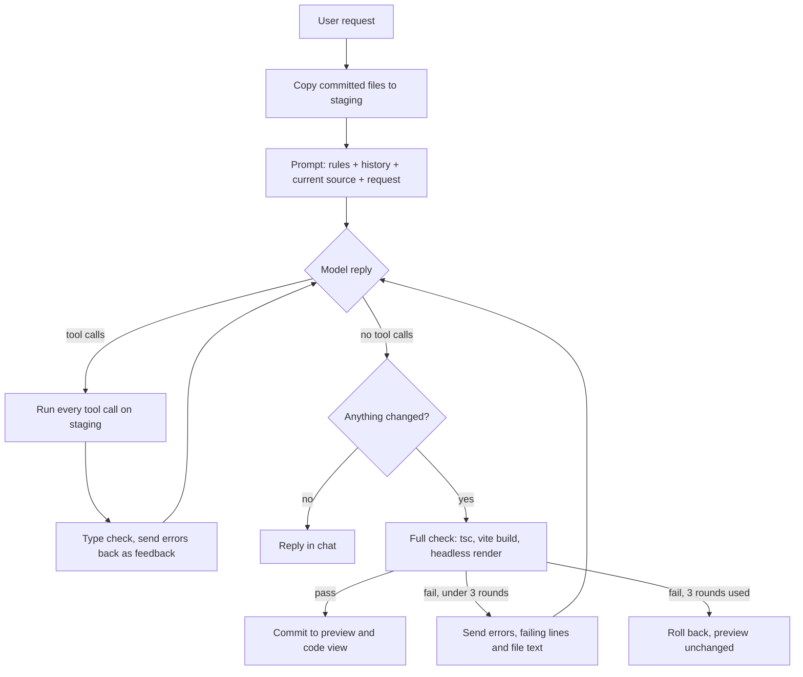

# UI Agent

**Describe a UI in plain English, watch it appear live, then refine it by chatting.**

UI Agent is a chat-driven coding agent that writes React + TypeScript + Tailwind code, renders it in a live preview next to the chat, and edits it on follow-up requests. Every change has to pass a type check, a production build, and a headless-browser render before it reaches the preview. When the agent makes a mistake, the errors go back to it and it fixes its own code.

> **Demo video:** _add link here_. The recording shows a multi-turn session: building a UI, a targeted follow-up edit, and an error the agent recovers from.

---

## Contents

- [What it does](#what-it-does)
- [Quick start](#quick-start)
- [Using the app](#using-the-app)
- [Architecture](#architecture)
- [The agent loop](#the-agent-loop)
- [Tools](#tools)
- [Context and memory](#context-and-memory)
- [How errors are caught and fixed](#how-errors-are-caught-and-fixed)
- [Isolation and security](#isolation-and-security)
- [Testing and evaluation](#testing-and-evaluation)
- [Design decisions and trade-offs](#design-decisions-and-trade-offs)
- [Known limitations](#known-limitations)
- [What I would build next](#what-i-would-build-next)
- [Project structure](#project-structure)
- [Configuration and API](#configuration-and-api)

---

## What it does

| Requirement | How UI Agent meets it |
| --- | --- |
| **Real agent loop, the LLM chooses its tools** | One loop, four tools (`read_file`, `write_file`, `edit_file`, `delete_file`). The model decides what to call and when it is done. The server only runs the tools and enforces limits. |
| **Self-correction on build errors** | After every step that changes files, a TypeScript check runs and errors go back to the model. When the model says it is done, the server type-checks, builds, and renders the app in a headless browser. Failures come back with the failing lines and file text, and the model gets up to 3 correction rounds. |
| **Generated code runs without errors** | A change is committed to the preview only after the full check passes. A failed turn is rolled back, so the preview never shows a broken state. Runtime crashes after load are reported by the preview and can be sent back to the agent with one click. |
| **Chat interface with follow-ups** | One conversation per session. Every request builds on the UI that is on screen. |
| **Live preview next to the chat** | A separate Vite dev server renders the generated app in an iframe and refreshes after each commit. |
| **Code view in sync with the preview** | The code tab is filled from the same commit event as the preview. Files changed in the last turn are marked. |
| **Follow-ups are targeted edits, not rewrites** | `edit_file` does exact search-and-replace. `write_file` refuses to replace a long file that is already on screen. In the eval, follow-ups kept 99 to 100% of the existing lines. |
| **Context across turns** | Each request includes the current source and a short history of earlier requests and outcomes, so "make it green" works without naming a file. |
| **Variety of UI** | Evaluated on forms, dashboards, landing pages, and small interactive apps (todo, Pomodoro, Kanban, weather). |
| **Isolation** | The preview runs on a different origin with a strict Content-Security-Policy. All agent writes are path-jailed to a staging folder, and the preview's entry files are locked. |
| **Secrets in environment variables** | The API key lives in `.env`, which is gitignored. Only `.env.example` is committed. |

---

## Quick start

### Prerequisites

- **Node.js 20+**
- **Python 3.11+**
- An **OpenAI API key** (the default model is `gpt-4o-mini`)

### Setup

```bash
# 1. Get the code (clone the repo, or unzip the archive and cd into it)
git clone https://github.com/parvthummar/UI_generating_coding_agent.git
cd UI_generating_coding_agent

# 2. Add your API key
cp .env.example .env              # Windows PowerShell: copy .env.example .env
#    then open .env and set LLM_API_KEY

# 3. Create and activate a Python virtual environment
python -m venv .venv
source .venv/bin/activate         # Windows: .venv\Scripts\activate

# 4. Install everything and start all three servers
npm run setup
npm run dev
```

Open **http://localhost:5173**.

`npm run setup` installs the root, client, and sandbox packages, downloads the Chromium build used by the render check, installs the Python requirements, and resets the preview to a blank starter page. `npm run dev` starts three processes:

| Process | Port | What it is |
| --- | --- | --- |
| Client | 5173 | The chat app you use |
| Sandbox | 5174 | The live preview of the generated UI |
| Server | 8000 | The FastAPI backend that runs the agent |

**Troubleshooting**

- *"browser is missing" during validation:* run `npx playwright install chromium` inside `sandbox/`.
- *A port is already in use:* the servers use fixed ports and fail loudly. Stop the process holding 5173, 5174, or 8000. The ports also appear in the CORS setting, the iframe and API URLs, and the preview's content policy, so stopping the other process is easier than changing them.
- *`python` or `pip` not found, or packages missing:* activate the virtual environment first, then rerun `npm run setup`.

---

## Using the app

1. **Describe a UI.** Type a request such as *"Finance dashboard with summary cards, a bar chart of spending, and a transactions table"*, or click one of the starter prompts.
2. **Watch the agent work.** The chat shows a live activity block: each file it writes or edits, each type check, and the final validation. If it had to fix its own errors, the block gets a **self-corrected** badge.
3. **See the result.** When the change passes all checks, the preview refreshes and the **Code** tab shows the files, with the ones changed in this turn marked.
4. **Refine it.** Send follow-ups such as *"Add a dark mode toggle in the header"*. The agent edits only what is needed.
5. **Recover from crashes.** If a click crashes the preview, a banner appears with **Ask the agent to fix this**, which sends the error and stack trace through the same checked loop.
6. **Undo** restores the previous committed version. **New session** clears the chat and resets to a blank page.

Example prompts that work well:

- *Contact form with name, email and message, validation, and a success message*
- *Landing page for a fictional coffee brand with hero, features, pricing and footer*
- *Kanban board with 3 columns and buttons to move cards*
- *Activity feed that uses the date-fns library to show relative dates*: `date-fns` is not installed, so this reliably shows the agent recovering from a build error.

---

## Architecture

```
 Browser  http://localhost:5173                      Preview  http://localhost:5174
┌────────────────────────────────┐                  ┌──────────────────────────────┐
│ Client (React + Tailwind)      │   iframe          │ Sandbox (Vite + React)       │
│  chat · activity · code view   │ ────────────────▶ │  src/main.tsx   (locked)     │
│                                │ ◀──────────────── │  src/App.tsx    (agent)      │
└───────────────┬────────────────┘   postMessage:    │  src/components (agent)      │
                │                    runtime errors  └──────────────▲───────────────┘
                │ POST /api/chat (streamed events)                  │ commit copies
                ▼                                                   │ checked files
┌────────────────────────────────────────────────────────────────────┴───────────────┐
│ Server (Python, FastAPI)   http://localhost:8000                                    │
│  agent loop ── tools ──▶ sandbox/.staging/src   (path-jailed working copy)          │
│      │                     │                                                        │
│      │                     └─▶ validation: tsc ─▶ vite build ─▶ Playwright render   │
│      ▼                                                                              │
│  OpenAI API (tool calling)                                                          │
└─────────────────────────────────────────────────────────────────────────────────────┘
```

| Part | Stack | Role |
| --- | --- | --- |
| `client/` | React 18, TypeScript, Tailwind 4, Vite | Chat, activity stream, preview frame, code view. Reads the server's event stream with `fetch`. |
| `server/` | Python 3.11, FastAPI, `openai` SDK | Runs the agent loop, the tools, validation, commit and rollback, sessions. |
| `sandbox/` | Vite, React, Tailwind, recharts, lucide-react, framer-motion | The project the agent edits. Serves the live preview. Holds the validation scripts. |

There are two copies of the generated project:

- **Staging** (`sandbox/.staging/src`): the working copy the agent edits during a turn.
- **Committed** (`sandbox/src`): what the preview serves. Files are copied here only after validation passes.

---

## The agent loop



One turn, step by step:

1. **Stage.** Copy the committed project into the staging folder. The agent never writes to the preview directly.
2. **Prompt.** Send the system prompt, the last 10 turns of history, and the request with the **current source of every file** attached. If the project is still the blank starter, the message says so.
3. **Act.** The model replies with tool calls. The server runs all of them in order, up to 12 per step, and streams each one to the chat.
4. **Check while building.** After a step that changed files, `tsc` runs and any errors go back to the model with the failing source lines quoted. This is feedback, not a failure: a half-built UI that imports a component it writes one step later is normal.
5. **Finish and validate.** When the model stops calling tools, the server runs the full check: `tsc --noEmit`, then `vite build` of the staging copy, then a Playwright render that fails on any uncaught exception or error-boundary crash.
6. **Commit or correct.** If the check passes, the files are copied to the preview and the chat and code view update. If it fails, the errors go back to the model for another round.
7. **Roll back if needed.** After 3 failed checks or 16 model calls, staging is discarded, the preview stays exactly as it was, and the history records that the request failed.

The router, editor, debugger, and reviewer roles are not separate agents. They are modes of the same loop, driven by the system prompt and the tool results.

| Limit | Value |
| --- | --- |
| Model calls per turn | 16 |
| Correction rounds (failed full checks) | 3 |
| Tool calls run per step | 12 |
| Source shown in the prompt | 30,000 characters, then files are listed by description |
| History kept | Last 10 turns |

---

## Tools

The model gets four tools. There is deliberately no "run the compiler" tool: the server always runs the checks, so the model cannot skip them.

| Tool | Arguments | Behavior |
| --- | --- | --- |
| `read_file` | `path` | Returns the full text of a file under `src/`. |
| `write_file` | `path`, `content`, optional `description` | Creates a file or replaces it. Replacing a file that **was already on screen and has more than 60 lines** is refused, which forces targeted edits on follow-ups. Files created during the current request can be rewritten freely while the model fixes them. |
| `edit_file` | `path`, `old_str`, `new_str`, optional `description` | Replaces exactly one occurrence of `old_str`. If there are zero or several matches, it changes nothing and returns the current file text so the model can retry. Indentation differences are tolerated when the match is still unique. |
| `delete_file` | `path` | Deletes a file. Refuses `App.tsx`. |

**Guardrails built into the tools:**

- Every path is resolved and must stay inside `sandbox/.staging/src`. `../x`, absolute paths, and sibling folders are rejected.
- `main.tsx` and `index.css` are locked. Only `.ts` and `.tsx` files can be written. There are at most 25 component files of 40 KB each.
- Every error starts with `ERROR:` and says how to fix the call, so the model can retry instead of stalling.
- The generated UI may only import pre-installed packages: `react`, `react-dom`, `lucide-react`, `recharts`, `framer-motion`, `clsx`, `tailwind-merge`, and Tailwind. A made-up import fails the type check and gets corrected.

---

## Context and memory

- **Current state:** every request carries the committed source, so the model edits exactly what the user sees and copies `old_str` from real text.
- **Conversation:** the session keeps the last 10 turns as short notes, for example *"Added a dark mode toggle. Files changed: src/App.tsx, src/components/ThemeToggle.tsx."* Raw tool calls and old file dumps are not stored, which keeps the prompt small.
- **Failures are remembered:** a rolled-back turn is recorded as *"FAILED and rolled back"*, so the next request does not assume that change exists.
- **Scope:** one in-memory session. Files on disk survive a server restart. Chat history does not.

---

## How errors are caught and fixed

Errors are caught in four layers. Each layer sends the error back to the model in a form it can act on.

| Layer | When | What the model gets |
| --- | --- | --- |
| Tool errors | A bad tool call: `old_str` not found, a path outside `src/`, a rewrite of a long file on screen | An `ERROR:` message with the current file text and how to fix the call |
| Type check while building | After each step that changed files | Compiler errors, the quoted failing lines, an exact import line when a component or hook is used without being imported, and the name of any invisible invalid character |
| Full check before commit | When the model says it is done | Errors from `tsc`, `vite build`, or the headless render, plus the current text of the cited files. Up to 3 rounds. |
| Runtime crash in the preview | After commit, when a click throws | A banner with **Ask the agent to fix this**, which sends the message and stack through the same loop |

Two extra safeguards stop the model from going in circles:

- If an error repeats one seen earlier in the turn, the model is told its last change did not fix it and is shown the current files.
- If the model describes a plan but calls no tools, it is asked once to make the change.

**Example from the eval.** Asked for an activity feed using `date-fns`, which is not installed, the agent imported it. The type check reported *"Cannot find module 'date-fns'"*. The agent rewrote the relative-date logic in plain TypeScript, and the turn committed cleanly, with no broken state ever shown in the preview.

---

## Isolation and security

- **Separate origin:** the preview runs on port 5174 and the app on 5173. Different ports are different origins, so preview code cannot read the app's page or storage. The iframe `sandbox` attribute alone, with `allow-same-origin`, would not be enough on the same origin.
- **No network from the preview:** a Content-Security-Policy limits the preview to its own origin, so generated code cannot call external services or load remote assets. Vite may only serve files inside `sandbox/`, so the preview cannot reach `.env` or the server code.
- **The API is locked to the app:** the server's CORS allows only `http://localhost:5173`.
- **Write jail and locked files:** the agent can only write `.ts` and `.tsx` files under the staging `src/` folder, and cannot touch the preview's entry point or styles.
- **Secrets:** the API key is read from `.env`, which is gitignored. It is never put into prompts, tool results, or logs.

This is browser-level isolation for a local prototype, not an operating-system sandbox.

---

## Testing and evaluation

### Unit and integration tests (no API key needed)

```bash
cd server
python -m scripts.test_tools
```

112 checks against the real compiler, build, and browser. They cover the tools and path jail, commit and rollback, the validation pipeline, and **scripted agent turns that replay failure modes seen during development**:

- the first write to the blank starter
- a UI that imports components it writes in a later step
- eight tool calls in one step
- rewriting a broken file created in the same turn
- a model toggling between two broken versions
- a model that describes a plan without acting
- a follow-up that must leave the other files byte-for-byte identical
- a request right after a rollback

They also check the browser interaction checker against working and deliberately broken fixtures.

### Model eval

```bash
cd server
python -m scripts.eval        # writes eval/results.md
```

The eval runs each prompt from a blank project, then its follow-up in the same session. It records:

- model calls, self-correction steps, fix attempts, and time
- for follow-ups, which files changed and how many of the previous lines were kept
- for interactive apps, the result of a Playwright check that types, clicks, and reads the page: add a task, start and pause the timer, move a card, switch the temperature unit

**Latest run with `gpt-4o-mini`** (full table in [eval/results.md](eval/results.md)):

| # | Kind | Prompt | Result | Model calls | Self-correction steps | Previous lines kept |
| --- | --- | --- | --- | --- | --- | --- |
| 1 | Form | Contact form with validation and success message | committed | 5 | 1 | |
| F4 | Follow-up | Make the message field optional | committed | 2 | 0 | 99% |
| 2 | Dashboard | Finance dashboard with cards, bar chart, transactions | committed | 2 | 0 | |
| F1 | Follow-up | Add a dark mode toggle in the header | committed | 8 | 5 | 99% |
| 3 | Landing page | Coffee brand: hero, features, pricing, footer | committed | 2 | 0 | |
| F3 | Follow-up | Main color green, add testimonials | committed | 6 | 3 | 99% |
| 4 | Small app | Todo with add, complete, delete, filter | committed | 2 | 0 | |
| F2 | Follow-up | Show how many tasks are left | committed, interaction pass | 2 | 0 | 100% |
| 5 | Small app | Pomodoro timer with start, pause, reset | committed, interaction pass | 3 | 1 | |
| 6 | Form | Login and sign-up with a toggle | committed | 2 | 0 | |
| 7 | Small app | Kanban with 3 columns and move buttons | committed, interaction inconclusive | 2 | 0 | |
| 8 | Dashboard | Weather card with °C/°F toggle | committed, interaction pass | 3 | 0 | |
| E1 | Self-correction | Activity feed using the uninstalled `date-fns` | committed | 5 | 2 | |

**Summary:** 9 of 9 new UIs and 4 of 4 follow-ups committed. 5 of the 13 commits happened only after the agent fixed its own errors. Every follow-up kept 99 to 100% of the existing code.

Runs are not deterministic. Over repeated runs, an occasional turn still rolls back cleanly, and the interaction check has caught generated Kanban boards whose move buttons did nothing. For comparison, the first version of this agent committed 3 of 12 rows on the same eval. The fixes that closed the gap are described in the trade-offs below.

### See the loop from a terminal

```bash
cd server
python -m scripts.cli
```

This runs the same agent without the browser and prints every event: each tool call the model chose, each type check, and the commit or rollback.

---

## Design decisions and trade-offs

- **One agent with four tools, not several agents.**
  - *Why:* fewer model calls, lower cost, and one place to debug.
  - *Cost:* no specialist planner or reviewer. I would split roles only if the eval showed a gain.
- **The current source goes into every prompt.**
  - *Why:* the model edits what it can actually see, so it does not guess at `old_str` or spend steps on `read_file`.
  - *Cost:* tokens, so the snapshot is capped at 30,000 characters, and larger projects fall back to a file list plus `read_file`.
  - *History:* an earlier version sent only a file catalog and required a read before every write. That rejected the very first write of each new UI and caused most rollbacks.
- **Mid-build type errors are feedback; only a failed final check counts as a correction.**
  - *Why:* counting mid-build errors used up the 3 correction rounds before a UI was even finished.
- **Search-and-replace edits instead of diffs or full rewrites.**
  - *Why:* models reproduce exact strings more reliably than line-numbered patches, and ambiguous matches are rejected instead of editing the wrong place.
  - *How:* the 60-line rewrite limit applies only to files already on screen, which keeps follow-ups targeted while letting the model rewrite a file it just created.
- **Type check, then production build, then headless render, all on a staging copy.**
  - *Why:* a type check alone let through UIs that crashed on load. Validating staging keeps the preview untouched until the change is proven.
  - *Cost:* a few seconds per check, and the render check covers the first load, not every click.
- **A fixed package list.**
  - *Why:* made-up imports are the most common build error from models, and a known list makes them fail fast and get fixed.
  - *Cost:* the agent cannot add libraries.
- **A local Vite sandbox instead of a cloud sandbox.**
  - *Why:* free and fast hot reload, real Vite behavior, no external service.
  - *Cost:* one user and one session at a time.
- **Python server, Node only for the preview and the checks.**
  - *Why:* fast to write and read.
  - *Cost:* two runtimes to install.
- **In-memory session.**
  - *Why:* no database to set up.
  - *Cost:* chat history is lost on restart. Files and undo snapshots stay on disk.
- **Deterministic hints over more model calls.**
  - *Why:* when the cause of an error is mechanical (a missing import, an invisible character, a repeated broken state), the server states the fix directly. That is cheaper and more reliable than hoping the model notices.

---

## Known limitations

- Single user, single session, one sandbox folder.
- The render check covers the first load. Bugs that only appear on interaction are caught by the eval's interaction checks or the in-app crash banner, not by the commit gate.
- `gpt-4o-mini` sometimes writes interaction logic that does not work (for example a move button with the wrong target) or skips a requested feature. A stronger model improves this, set `LLM_MODEL` in `.env`.
- Once `App.tsx` grows past 60 lines, a completely different UI has to be built through edits. **New session** is the clean way to start over.
- The commit copies files one at a time, so the preview can flash an in-between state for a moment.
- Isolation is browser-level (separate origin and CSP), not an operating-system sandbox.
- No syntax highlighting in the code view. Undo keeps a short linear history only.

---

## What I would build next

1. **Interaction checks inside the commit gate.** Generate a few Playwright assertions from the request ("clicking Move puts the card in the next column") and treat failures like build errors.
2. **Visual feedback.** Give the model a screenshot of its render so it can fix layout and styling issues it cannot see in the code.
3. **Per-session sandboxes** (or an in-browser bundler such as Sandpack) so many users can work at once and the app can be hosted.
4. **Diff view and richer undo.** Show what each turn changed and allow jumping back to any earlier version.
5. **Planner and reviewer split.** Only if the eval shows a gain, for example a cheap model for edits and a stronger one for planning new UIs.
6. **Parallel, repeated eval runs** with success-rate confidence intervals, since single runs vary.

---

## Project structure

```
.
├── client/                    Chat app (React + Tailwind), port 5173
│   └── src/App.tsx            Chat, activity stream, preview frame, code view
├── server/                    Python backend, port 8000
│   ├── app/
│   │   ├── main.py            FastAPI routes and event streaming
│   │   ├── agent.py           The agent loop, error feedback, commit gate
│   │   ├── tools.py           The four tools, path jail, edit rules
│   │   ├── validate.py        tsc, vite build, headless render
│   │   ├── workspace.py       Staging, commit, rollback, undo snapshots
│   │   ├── llm.py             OpenAI calls with rate-limit backoff
│   │   ├── prompts.py         System prompt
│   │   └── sessions.py        Conversation history
│   ├── scripts/
│   │   ├── test_tools.py      112 checks, no API key needed
│   │   ├── eval.py            Model eval, writes eval/results.md
│   │   ├── cli.py             Run the agent from a terminal
│   │   └── reset.py           Reset the preview to the starter page
│   └── template/src/App.tsx   Blank starter page
├── sandbox/                   Preview project, port 5174
│   ├── src/main.tsx           Locked entry with error boundary and crash reporting
│   ├── scripts/smoke.mjs      Headless render check
│   ├── scripts/behave.mjs     Interaction checks used by the eval
│   └── vite.staging.config.ts Builds the staging copy for validation
├── eval/results.md            Latest eval run
├── docs/SPEC.md               Design spec
└── .env.example               Configuration template
```

The generated UI files (`sandbox/src/App.tsx`, `sandbox/src/components/`) and the staging folder are runtime state and are gitignored.

---

## Configuration and API

**`.env`** (copy from `.env.example`):

| Variable | Default | Meaning |
| --- | --- | --- |
| `LLM_BASE_URL` | `https://api.openai.com/v1` | OpenAI-compatible endpoint |
| `LLM_MODEL` | `gpt-4o-mini` | Any chat model with tool calling |
| `LLM_API_KEY` | | Your API key |

**HTTP API** (used by the client):

| Route | Purpose |
| --- | --- |
| `POST /api/chat` | Body `{ "message": "..." }`. Streams events: `status`, `tool_call`, `files_updated`, `assistant_message`, `error`. Returns 409 if a turn is already running. |
| `GET /api/files` | The committed files as `{ "src/App.tsx": "..." }` |
| `POST /api/undo` | Restore the previous committed version |
| `POST /api/reset` | Restore the blank starter and clear the history |
